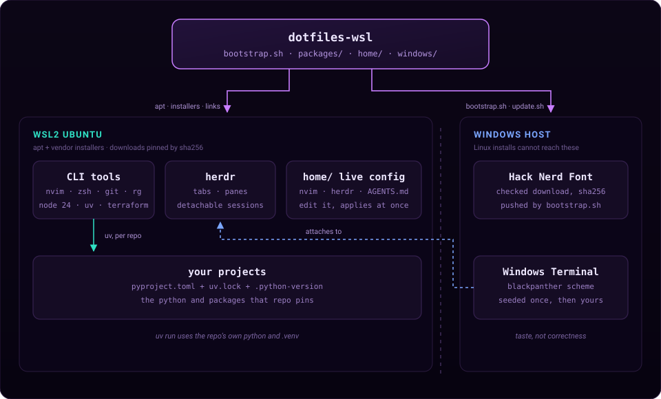

# dotfiles-wsl

My whole WSL2 Ubuntu setup, written down in files. One command puts it on a new
computer.

Get a new Windows laptop, clone this repo, run `./bootstrap.sh`, and you get the
same packages, the same shell, the same editor and the same terminal colours you
had before.

## What you get

- Packages from apt and their vendors' own installers, listed in `packages/`
- zsh, with command suggestions and colours
- The Starship prompt
- Neovim, set up and ready, with language servers so go-to-definition works
- herdr, a tool for running many terminals in one window
- One `AGENTS.md` file that every AI coding tool reads
- Hack Nerd Font, installed on the Windows side
- Your terminal colours, set up on the first install

## Contents

- [How it works](#how-it-works)
- [Before you start](#before-you-start)
- [Install](#install)
- [Everyday use](#everyday-use)
- [Neovim](#neovim)
- [herdr](#herdr)
- [Tools for one project](#tools-for-one-project)
- [Making changes](#making-changes)
- [What is in this repo](#what-is-in-this-repo)
- [What this repo can and cannot rebuild](#what-this-repo-can-and-cannot-rebuild)
- [Reference](#reference)

## How it works

Three ideas explain the whole repo.

**Anything that can live in WSL, lives in WSL.** Packages come from apt, from
the vendors' own apt repos (GitHub CLI, HashiCorp, NodeSource), from official
install scripts (uv, Databricks CLI), and from GitHub releases checked against a
SHA-256 (herdr, lua-language-server, the font). Delete your Linux install, clone
this repo, run `./bootstrap.sh`, and you are back where you were.

**Your home folder is shared, your projects are not.** This repo installs the
tools you want on *every* computer. A Python version that one project needs goes
in that project, with uv. See [Tools for one project](#tools-for-one-project).

**The terminal is a Windows program, so we set it up once and then leave it
alone.** Windows Terminal draws your window, and nothing installed inside Linux
can reach it. Two things cross over when you install: the font, and the colours.
After that the terminal is yours to change.

<p align="center">
  
</p>

Files under `home/` are linked, not copied. So when you edit one, the change
works right away. You only run a script again when you add or remove a package.

## Before you start

You need:

- Windows 10 22H2 or Windows 11, with **Windows Terminal** (already installed on
  Windows 11)
- WSL2 with Ubuntu. Install it with `wsl --install -d Ubuntu`
- `git` inside WSL: `sudo apt install -y git`
- Your Linux password: `bootstrap.sh` uses `sudo` for apt, and `chsh` asks for it
  once to make zsh your login shell

## Install

```bash
git clone https://github.com/<you>/dotfiles-wsl.git ~/dotfiles-wsl
cd ~/dotfiles-wsl
./bootstrap.sh
```

That is the whole install. You do not need to run anything on the Windows side.

| Step | What it does |
| --- | --- |
| 0 | Checks that you are in WSL |
| 1 | Adds the GitHub CLI, HashiCorp and NodeSource apt repos, then installs `packages/apt.txt` |
| 2 | Installs the Databricks CLI and uv with their official installers |
| 3 | Installs the language servers (npm and uv), herdr, lua-language-server and the font, each checked against its SHA-256 |
| 4 | Links the repo to `~/.dotfiles` and the files under `home/` into your home folder |
| 5 | Removes lines an older, Nix-based version of this repo added to `~/.profile` and `~/.bashrc` |
| 6 | Makes zsh your login shell |
| 7 | Installs Hack Nerd Font on Windows |
| 8 | Sets your terminal colours, one time only |

**Already like your terminal?** Step 8 replaces your colours, font, opacity and
background **once**. Your own colour schemes are kept, so you can switch straight
back in Windows Terminal's Settings screen, and the old `settings.json` is backed
up next to itself. To skip it entirely and keep the font only:

```bash
DOTFILES_SKIP_THEME=1 ./bootstrap.sh
```

When it finishes, close and reopen Windows Terminal. If you see boxes instead of
icons, sign out of Windows and back in. Windows needs this to notice a new font.

## Everyday use

```bash
./update.sh        # upgrade everything: apt, Databricks CLI, uv, npm globals
```

**The rule to remember:** files under `home/` are symlinked, so editing one
takes effect immediately (in a new shell, for zsh). Packages are installed by
`bootstrap.sh`, so a new package means editing `packages/` and running it again.

| You changed | Run |
| --- | --- |
| `packages/apt.txt`, `packages/pinned.sh` | `./bootstrap.sh`, then open a new shell |
| `home/.zshrc`, `home/.zshenv` | nothing, open a new shell |
| Neovim, herdr, starship, `AGENTS.md` (under `home/`) | nothing |
| Windows Terminal settings | nothing, it is a Windows program |

Check that this machine still matches the repo:

```bash
./scripts/check-drift.sh
```

## Neovim

Run `nvim`. The leader key is **space**. Press it and wait: which-key pops up a
list of what is available, so you do not have to memorise this table.

| Key | Does |
| --- | --- |
| `space` `f` | Find files by name |
| `space` `s` | Search text across the project |
| `space` `b` | Switch between open buffers |
| `space` `e` | File browser, edit the folder like a document |
| `space` `g` | Git interface (stage, commit, branch, diff) |
| `gd` | Go to definition |
| `Esc` | **Save.** Not "leave insert mode only" |
| `ctrl+a` | Select all |

If you are new to vim: `i` starts typing, `Esc` saves and stops typing, `:q`
quits, `:wq` saves and quits. `dd` deletes a line, `u` undoes, `ctrl+r` redoes.

Three things behave differently from stock vim on purpose:

- **`Esc` saves the file.** Convenient, and worth knowing before it surprises you.
- **Pasting over selected text keeps your clipboard.** Normally vim replaces
  your clipboard with whatever you just overwrote. Here you can paste the same
  thing repeatedly.
- **Copy and paste reach Windows.** Yanking puts text on the Windows clipboard
  and `ctrl+v` from a Windows app works, because the config routes through
  `clip.exe` and `powershell.exe`. WSL has no other way to do this.

Line numbers are relative, so `5k` jumps up five lines. Search is
case-insensitive unless you type a capital. Undo survives closing the file.

Language servers are wired up for Lua, Python, JavaScript/TypeScript and Bash,
so `gd`, diagnostics and hover work in those files. They are installed by
`bootstrap.sh` (npm and uv globals, and lua-language-server pinned in
`packages/pinned.sh`), not by mason, so they appear on a new machine like every
other tool. Adding another means adding it to `packages/pinned.sh` and its name
in `home/.config/nvim/lua/plugins/lsp.lua`.

To add a plugin, drop a file into `home/.config/nvim/lua/plugins/`. lazy.nvim
loads everything in that folder. Nothing to run.

## herdr

A terminal multiplexer: many terminals in one window, and they keep running
when you close the window. Useful for leaving builds or AI agents working.

```bash
herdr
```

Every shortcut starts with the **prefix**, `ctrl+b`. Press it, let go, then
press the next key.

| Prefix then | Does |
| --- | --- |
| `?` | **Show every shortcut.** Start here |
| `c` | New tab |
| `&` | Close tab |
| `"` | Split top and bottom |
| `%` | Split left and right |
| `h` `j` `k` `l` | Move between panes, left/down/up/right |
| `w` | Workspace picker |
| `g` | Jump to a specific tab |
| `y` | Copy mode, to scroll back and select text |
| `q` | Detach, leaving everything running |

In copy mode: `v` or `space` starts selecting, `y` or `Enter` copies, `q` or
`Esc` leaves. Those are fixed by herdr and cannot be reconfigured.

Note `q` detaches, not `d` as in tmux.

Detaching is the whole point of using herdr. Close the terminal, come back
later, run `herdr` again and you are reattached with everything still running.

The keys live in `home/.config/herdr/config.toml`. It is symlinked, so edits
apply to the next herdr you start.

## Tools for one project

This repo installs tools you want everywhere: Node 24, uv, git, ripgrep, Neovim,
Terraform. A Python version or package set for one project goes in that project,
and uv handles both:

```bash
cd ~/my-api
uv init --python 3.12      # writes pyproject.toml and .python-version
uv add requests            # pins packages in uv.lock
uv run python --version    # Python 3.12.x, downloaded by uv if needed
```

`.python-version`, `pyproject.toml` and `uv.lock` travel with the code, so the
next laptop gets the same interpreter and packages with `uv sync`.

Node is the global Node 24 for every project. A project that truly needs another
Node version has no per-project switcher here; that was a feature of the old
Nix setup that this repo gave up.

`direnv` is still installed: an `.envrc` with `dotenv` or `source .venv/bin/activate`
loads when you `cd` in and unloads when you leave.

## Making changes

**Add a command line tool.** If apt has a recent enough version, add it to
`packages/apt.txt`. If not, add a download with its version and SHA-256 to
`packages/pinned.sh` and an install block to step 3 of `bootstrap.sh`, following
herdr's. Then run `./bootstrap.sh`.

**Add a shell shortcut.** Add it to `home/.zshrc`. Open a new shell.

**Change terminal colours, see-through level or padding.** Use Windows
Terminal's own Settings screen. This repo sets the colours once when you install
and never writes that file again. If you want to save new colours for future
computers, edit the files in `windows/` and run
`./scripts/apply-windows-terminal-theme.sh --force`.

**Ship your own theme instead of mine.** Replace `windows/blackpanther.json`
with your scheme, `windows/blackpanther.jpg` with your background, and point
`SCHEME_FILE` and `IMAGE_FILE` at the top of
`scripts/apply-windows-terminal-theme.sh` at them. The scheme's `name` must
match `colorScheme` in `windows/profile-defaults.json`; the script refuses to
run if they disagree, because Windows Terminal would otherwise silently ignore
a scheme it cannot resolve.

**Add a Neovim plugin.** Put a file in `home/.config/nvim/lua/plugins/`.
lazy.nvim loads every file in that folder. Nothing to run.

**Change how AI tools behave.** Edit `home/AGENTS.md`. Claude Code, Codex and
opencode all read it. Nothing to run.

**Use a different terminal.** Nothing here needs Windows Terminal. Install
whatever you like. You only need Hack Nerd Font and truecolor support. See
[the reference](docs/README.md#the-terminal).

## What is in this repo

```
dotfiles-wsl/
├── bootstrap.sh                    # first-time setup; safe to re-run
├── update.sh                       # upgrade everything installed
├── packages/
│   ├── apt.txt                     # apt packages, one per line
│   └── pinned.sh                   # GitHub downloads: version + SHA-256
├── scripts/
│   ├── link.sh                     # links home/ into your home folder
│   ├── install-windows-font.sh     # font to Windows
│   ├── apply-windows-terminal-theme.sh   # colours to Windows, install only
│   └── check-drift.sh              # does this machine match the repo?
├── windows/                        # what gets copied to the Windows side
│   ├── blackpanther.json           # the colour scheme
│   ├── profile-defaults.json       # font, see-through level, padding, cursor
│   └── blackpanther.jpg            # background picture
├── home/                           # linked into your home folder
│   ├── .zshrc, .zshenv             # shell
│   ├── AGENTS.md                   # shared notes for every AI tool
│   └── .config/
│       ├── starship.toml
│       ├── herdr/config.toml
│       └── nvim/
│           ├── init.lua
│           └── lua/
│               ├── vim_config.lua  # settings + the Windows copy-paste fix
│               ├── plugin.lua      # lazy.nvim setup
│               ├── keys.lua
│               └── plugins/        # one file per plugin
└── docs/README.md                  # what every file does, and when to edit it
```

## What this repo can and cannot rebuild

This matters, because rebuilding is the whole point.

**Exactly the same on every machine**, pinned by version and SHA-256 in
`packages/pinned.sh`: herdr, lua-language-server and the font files. Plus every
link into your home folder.

**The same package, a version that depends on when you install**: everything
from apt and the vendor repos (zsh, git, gh, Neovim, Node 24.x, Terraform, ...),
uv, the Databricks CLI and the npm language servers. Two laptops installed on
different days can be a minor version apart. `./update.sh` on both brings them
level. This is the trade made by leaving Nix: simpler tooling, no lockfile.

**Exactly the same for each project**, pinned by that project's own `uv.lock`
and `.python-version`: its Python and packages.

**Set once when you install, then yours**: terminal colours, font size,
see-through level and background picture. A new computer gets your look
automatically. After that, this repo never writes that file again, so nothing
undoes a change you make yourself.

**Not managed at all**: Windows Terminal itself, and Windows desktop settings.

**On purpose, not locked**: Neovim plugins, managed by lazy.nvim. Commit
`home/.config/nvim/lazy-lock.json` if you want to lock them. AI tools that update
themselves, like Claude Code, are also left alone. See
[the reference](docs/README.md#decisions-that-will-surprise-you).

## Reference

[docs/README.md](docs/README.md) is the full reference: every file and what it
does, which one to open when you want to change something, the decisions that
look like bugs but are not, and a symptom-to-fix table.

## License

[MIT](LICENSE). Use it, change it, ship it. Keep the copyright notice.
